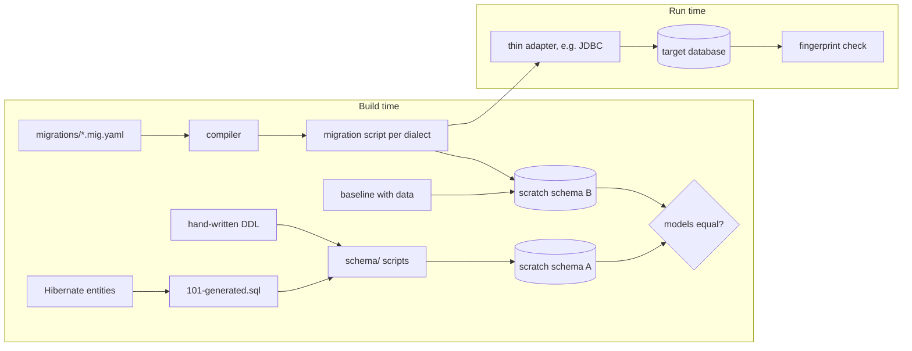

# MIG-Ace architecture

Status: design phase, nothing is implemented yet. Last updated 2026-11-17.

This document records what has been decided for MIG-Ace, what is the current working direction, and what is still open. It replaces all earlier design notes.

Every statement carries one of three markers:

| Marker | Meaning |
|---|---|
| **[decided]** | Explicitly agreed. Change it only with a new decision. |
| **[direction]** | Proposed and used as the working assumption, but not yet explicitly confirmed. |
| **[open]** | Not settled. See [Open questions](#13-open-questions). |

## 1. Purpose and scope

MIG-Ace is a schema migration framework. It migrates a database that already contains data and then proves that the result is identical to the schema the application expects.

- **First target:** PostgreSQL, with Hibernate as the producer of the generated part of the schema. **[decided]**
- **Later targets:** other databases, in both senses. The framework supports more databases, and one application can ship to different customers on different databases. **[decided]**
- **Hibernate coupling:** Hibernate is only a producer of a DDL file. Nothing else in MIG-Ace depends on it. **[decided]**
- **Deployment:** how the migration is started (Kubernetes job, init container, DBA, script) is not part of the framework. Key environments are tested and documented as examples. **[decided]**
- **Origin:** the design generalises a framework that has run for about ten years on Oracle, with several customer installations on different versions that upgrade in their own rhythm, including version skips.

## 2. Principles

1. **The desired schema is the truth, and migrations are proven against it.** A migration is accepted only if it turns an older database with data into exactly the desired schema. **[decided]**
2. **Use the full power of the database.** The desired schema is whatever the real database contains after the schema scripts ran. It is never derived from Hibernate's object model. **[decided]**
3. **Migrations are exercised on data.** Test data is part of every snippet that changes the shape of a table. **[decided]**
4. **Mishaps are normal.** Snippets can be changed, reordered and repaired after they were released. The framework records what really ran and makes every such change explicit. **[decided]**
5. **Avoid native SQL.** Native SQL is dialect-specific and has to exist once per supported database, so the neutral statement language covers as much as possible. **[decided]**
6. **No framework code stays in the database, and no framework library is needed at run time.** The migration is a generated script. **[direction]**
7. **Editor support is a first-class requirement.** **[decided]**

## 3. System overview



At build time the tool compiles snippets into one migration script per dialect and proves the script in the proof loop. At run time a thin adapter sends that script to the database. The application checks the schema fingerprint when it starts.

## 4. Desired state and the schema meta-model

### 4.1 Desired state

- The desired state is the set of SQL files in `schema/`, applied in lexical order to an empty scratch database. **[decided]**
- Generated files (for example `101-generated.sql` from Hibernate) and hand-written files (`102-…`, `103-…`) are peers. Several generated files are allowed. Whether a file was generated or written by hand makes no difference to the comparison. **[decided]**
- Views, functions, procedures and triggers live in `schema/` and are recreated at the end of every migration run. **[decided]**
- **Staleness check:** the build fails when the committed schema snapshot no longer matches what `schema/` produces. This holds for regenerated files and for manual edits to hand-written files alike. **[decided]**

### 4.2 Meta-model

- The schema is read from the real database catalog into a meta-model. Two meta-models are compared, never two DDL texts. **[decided]**
- The same meta-model is the source of generated snippets and of the schema fingerprint. **[decided]**
- Every attribute belongs to a significance tier. Only the logical tier takes part in comparison and fingerprint. **[direction]**

| Tier | Examples (PostgreSQL) | Compared | In fingerprint |
|---|---|---|---|
| Logical | tables, columns, types, nullability, defaults, keys, checks, indexes, sequences, views, functions, triggers, comments | yes | yes |
| Physical | tablespace, fill factor, storage parameters, statistics targets | no | no |
| Deployment | owner, grants, row-level security policies | no, switchable | no |

- Column order is not significant, because PostgreSQL can only append columns. **[direction]**
- Objects that belong to another object (the index behind a primary key, the sequence behind an identity column) are compared through their owner only. **[direction]**

### 4.3 Naming of constraints and indexes

The old framework renamed all constraints and indexes after every snippet. That step is dropped. **[direction]**

- A naming convention produces names when DDL is generated and when snippets are generated.
- A lint rule requires explicit names for constraints and indexes created in snippets.
- The comparison matches objects by definition first. A name difference with an identical definition is a separate, lower-severity finding.
- Table aliases are declared in configuration and mirrored into a database table, because the application and some snippets read that table. **[direction]**

### 4.4 Fingerprint

- The fingerprint is the hash of the canonical meta-model. **[decided]**
- It is recomputed from the real schema at the end of every migration run and compared with the expected value. A stored hash alone is not trusted. **[decided]**
- A run-time property excludes objects by pattern, so that local administrators can add indexes or other objects. **[decided]** Only additional objects can be excluded, never missing or changed expected ones. **[direction]**
- Because no library runs at migration time, the canonical model is produced by SQL, once per dialect, and the build uses the same SQL. **[direction]**
- The text PostgreSQL returns for views, defaults and checks can differ between major versions. The script therefore carries one expected fingerprint per supported major version. **[direction]**

## 5. The proof loop

The proof loop is the central test. **[decided]**

1. Build the desired state in scratch schema A from `schema/`.
2. Load a baseline, an older state with data and its ledger, into scratch schema B.
3. Run the compiled migration script on B, with test data inserted around each snippet.
4. Compare the meta-models of A and B. Any difference in the logical tier fails the build.
5. Run the script a second time. It must do nothing.

Details:

- **Baselines:** each supported release is a baseline. A baseline carries its ledger, so the loop applies exactly what that release is missing. **[direction]**
- **Upgrade paths:** paths that produce the same snippet sequence are tested once. Only out-of-order snippets (hotfixes) create additional sequences. Baselines can be synthesised from a release tag instead of stored as dumps. **[direction]**
- **Lost-hotfix check:** a release fails if a snippet from an older supported release is missing and not archived. **[direction]**
- **Scratch database:** the build must work on locked-down Windows machines without container support and inside containers that cannot start further containers. **[decided]** The scratch database is a provider interface. **[direction]**

| Provider | Use |
|---|---|
| Real PostgreSQL binaries started as a child process | default for the proof loop; same major version as production |
| PGlite (PostgreSQL compiled to WebAssembly) | editor meta-model and snippet generation **[decided]**; optional fast checks |
| Schema pair on a shared server | builds that cannot start processes |
| Testcontainers | optional convenience for other users |

## 6. Snippets

### 6.1 Files and identity

- A snippet is one file `migrations/<name>.mig.yaml`. **[decided]**
- Every snippet file is valid YAML. Without MIG-Ace tooling, any YAML editor with the published `schema.json` gives basic editing support. **[decided]**
- `uid` is the identity of a snippet. It is generated once and never changes. The ledger is keyed by it. **[direction]**
- The name (`YYYYMMDD-HHMM-slug`) defines the position. Renaming a snippet reorders it. Installations that already ran it match by `uid`. **[direction]**
- Part names are the identity of parts inside a snippet. **[decided]**
- An optional LLM configuration proposes part names when snippets are generated. It runs at build time only, never renames existing parts, and has a deterministic fallback. **[decided]**

### 6.2 YAML profile

The grammar supports only the YAML constructs that snippets need. **[decided]**

- **Supported:** block mappings with plain keys, block sequences, single-line plain values, literal `|` blocks, `#` comments, single-line flow maps.
- **Not supported:** anchors, aliases, tags, multiple documents, folded `>` scalars, multi-line plain scalars, quoted keys, tabs.

Three places need care in the grammar. **[decided]**

1. A literal block ends by indentation, while the statement inside may be indented freely.
2. How a value is lexed depends on its key: after `do:` it is the statement language, after `doc:` it is free text.
3. A one-line statement that a YAML parser would read differently (it contains ` #` or `: `, or starts with a character such as `@`, `*`, `{` or a quote) is rejected with the advice to use a `|` block.

A conformance test parses every example with the MIG-Ace grammar and with a reference YAML parser and requires the same structure. The same files are validated against `schema.json`. **[direction]**

### 6.3 Structure

Top-level keys:

| Key | Meaning | Status |
|---|---|---|
| `migration` or `repair` | snippet name; `repair` marks a repair snippet | direction |
| `uid` | identity | direction |
| `doc` | description | direction |
| `when` | condition for the whole snippet | direction |
| `let` | named conditions | direction |
| `parts` | ordered list of parts | decided |
| `testdata`, `testdata-before` | test data inserted after or before the snippet | decided |
| `changed` | reason for an intentional change to a released snippet | decided |
| `retired`, `requires-downtime`, `former-names`, `before`, `after` | mishap and ordering controls | direction |

Each part is a list entry whose key is the part name. It holds exactly one operation and optional sibling keys.

| Operation key | Meaning | Status |
|---|---|---|
| `do` | one statement in the neutral statement language | direction (key name open) |
| `insert` | insert in YAML form | decided |
| `upsert` | idempotent insert of rows by key | direction |
| `native` | dialect-specific SQL, one entry per dialect | direction |
| `stop` | end the run with instructions for a case the tool cannot repair | direction |

| Sibling key | Meaning | Status |
|---|---|---|
| `when` | skip the part if false | direction |
| `verify-before` | fail before execution if false | decided |
| `verify-after` | fail after execution if false | decided |
| `batch` | run a data statement in batches | direction |
| `expect-rows` | allowed range of affected rows | direction |

### 6.4 Statement language

The statement language follows common SQL where a portable form exists and adds only what is missing. **[decided]** The MIG-Ace grammar parses every statement, so a syntax error in a statement is a build error. **[decided]**

- **Schema statements:** `create table`, `alter table … add column`, `alter table … add constraint`, `create index`, `drop …` in standard form. `ensure column …` is an addition: it adds the column if missing, widens it if narrower, skips if it matches, and fails on anything unsafe. **[direction]**
- **`update`:** `update <table> [alias] set col = expr, … [where …]`. No `from` join.
- **`delete`:** `delete from <table> [alias] [where …]`.
- **`insert`:** `insert into <table> (cols) values (…)`, or with a `select` from one table.
- **Subqueries:** scalar subqueries and `exists (…)` / `in (…)`, each over one table.
- **Expressions:** arithmetic, `||`, comparisons, `and/or/not`, `is null`, `in`, `between`, `like`, `case`, `cast`, and a list of portable functions.
- **Sequences:** `next value for <sequence>`.
- Keywords and unquoted identifiers are case-insensitive.

A condition must never restate what the operation already says. **[decided]**

### 6.5 Conditions and verification

- `when` decides whether a part or snippet runs. Conditions test the current state where possible (`column orders.legacy_due exists`) and the history where necessary (`ran <snippet>.<part> …`). **[direction]**
- A snippet or part whose condition is false is recorded as skipped and is evaluated again on the next run. **[direction]**
- `verify-before` and `verify-after` accept a boolean expression or a list of quantifier checks. **[decided]**

```yaml
verify-after:
  - all:    orders.status_id is not null
  - none:   orders.status_text = ''
  - single: order_status.code = 'UNKNOWN'
  - exists: order_status.code = 'OPEN'
```

The table is taken from the column qualifier. For `all`, a row where the condition is unknown counts as a violation. **[direction]**

### 6.6 Native SQL and dialects

- All supported dialects are listed in one central configuration. **[decided]**
- Native SQL must be provided for every supported dialect. A missing dialect is a warning or an error, by configuration. **[decided]**
- A dialect added later starts from a fresh baseline, so older snippets need no variant for it. **[direction]**

### 6.7 Test data

- Nothing is inserted without a `testdata` entry. Authors provide meaningful values. **[decided]**
- Two modes per row: `fill: all` (every column has a value) and `fill: required` (only mandatory columns). **[decided]**
- Inside an explicit entry, columns the author did not specify are generated. **[decided]**
- A shortcut picks some valid referenced row, replacing `(select max(id) from …)`. **[decided]** Its spelling is open.
- **Coverage rule:** after a snippet, every affected table must have a row of each mode. **[decided]** Affected tables are those whose shape changed and those targeted by data statements. All tables are checked only when a native part changes data. **[direction]**

### 6.8 Examples

```yaml
migration: 20270301-0900-orders-due-date
uid: 01JD5P…
doc: Add orders.due_date; fill from legacy_due where present, else compute

parts:
  - add-column:
      do: alter table orders add column due_date date

  - from-legacy:
      when: column orders.legacy_due exists
      do: |
        update orders set due_date = legacy_due
        where due_date is null and legacy_due is not null
      batch: 20000 by id

  - computed:
      do: |
        update orders
        set due_date = created_at + days(coalesce(payment_terms, 30))
        where due_date is null
          and (state = 'open' or (state = 'partial' and paid_amount < total))
      batch: 20000 by id
      verify-after:
        - none: orders.due_date is null and orders.state in ('open', 'partial')

  - index:
      do: create index concurrently ix_ord_due_date on orders (due_date)

  - drop-legacy:
      do: alter table orders drop column legacy_due

testdata-before:
  - table: orders
    fill: all
    row: { state: 'open' }
  - table: orders
    fill: required
```

Insert in both forms. They parse to the same operation.

```yaml
parts:
  - new-konto-sql:
      do: |
        insert into orders (id, a, b, status_id)
        values (next value for hibernate_sequence, 1, 2,
                (select max(id) from order_status))

  - new-konto-yaml:
      insert:
        into: orders
        values:
          id:        next value for hibernate_sequence
          a:         1
          b:         2
          status_id: (select max(id) from order_status)
```

A repair snippet:

```yaml
repair: 20270115-1200-repair-orders-status
uid: 01JD4M…
when: buggy

let:
  buggy_410: ran 20261120-1010-orders-status.backfill sha256:ab12…
  buggy_411: ran 20261120-1010-orders-status.backfill sha256:9f3e…
  buggy:     buggy_410 or buggy_411
  audited:   exists (select 1 from order_audit where field = 'status')

parts:
  - restore-from-audit:
      when: audited
      native:
        postgresql: |
          update orders o set status = a.old_value
          from order_audit a where a.order_id = o.id and a.field = 'status'

  - no-audit-data:
      when: not audited
      stop: |
        No audit rows. Restore orders.status from backup,
        then mark this snippet as done.
```

## 7. Ordering, changes and releases

### 7.1 Ordering and branching

- Snippets run in name order. Branches are merged by plain file merge, and CI decides whether the merged set works. There is no migration graph and no merge migration. **[decided]**
- An installation applies every snippet it has not run, in order, even when some are older than its newest applied snippet. This is normal and is recorded. **[direction]**
- Reordering is always possible, also after release, by renaming the snippet. **[decided]** Optional `before` and `after` constraints exist for cases where a rename is not wanted. **[direction]**

### 7.2 Changing released snippets

- At run time, a part that already ran is always skipped, whatever its current text says. There is no switch for this. **[decided]**
- The ledger keeps the checksum of the version that really ran, so a repair snippet can target it. **[direction]**
- Checksums are computed from the parsed operation, not from the file text. Formatting never changes a checksum. **[direction]**
- **Build guard against accidental edits:** every part of a released snippet must match its hash in at least one release file. Otherwise the build fails and names the part. **[decided]**
- **Intentional change:** the author adds `changed: <reason>` to the snippet. The next release records the new hashes, stores the reason and removes the marker, so the guard is active again. **[decided]**
- **Repair snippets** run only where a condition holds, for example where a specific faulty version ran. **[decided]**
- **Repairs that need downtime** must be possible, because a compatibility break will one day go undetected. **[decided]** A snippet can be marked `requires-downtime`. **[direction]**
- **Retired snippets** are never executed again, but stay in the sources because ledgers refer to them. **[direction]**

### 7.3 Release files

Each release writes one new file. Two branches that release the same cherry-picked snippet create two different files, so no merge conflict arises and no merge driver is needed. **[decided]**

```yaml
# releases/4.2.0.yaml, written by `mig release 4.2.0`
release: 4.2.0
date: 2027-03-15
based-on: [4.1.3]
snippets:
  01JD3K7M2Q8R5T1V4X6Z9B0C3F: { column: 3c9e10, backfill: a44b07, default: 0d51fe, not-null: 77a0b4 }
changed:
  01JCQ9A0PX3H7K2M8N4R6T1V5W:
    parts: { add-column: 9f3e21, backfill: c41d07, not-null: 77a0b4 }
    reason: backfill overwrote existing statuses; repaired by 20270115-1200-repair-orders-status
```

- A release file lists only snippets that are new or changed. **[decided]**
- A snippet is listed when its current part hashes are not already recorded identically in a release file present in the tree. **[direction]**
- `based-on` names the releases this one builds on. The full content of a release is its own entries plus those of everything it builds on. **[direction]**
- When a release builds on two releases that disagree about a snippet, the snippet is always written into the new file. **[direction]**
- A snippet listed in no release file is unreleased and can be edited freely. **[direction]**

### 7.4 Archiving

A command moves old snippets into a backup directory and moves the starting schema forward. **[decided]** The archived identities stay in an index, and an installation that has not reached the new starting point is told which release to install first. **[direction]**

## 8. Execution

### 8.1 Migration script

- The build produces one static script per dialect, for example `migration-script-pg.sql`. The script contains all logic: ledger, conditions, retries, batching and the fingerprint check. **[direction]**
- The script can be run repeatedly. Only missing steps are executed. **[decided]**
- Supporting another database means writing another compiler target. **[direction]**
- The compiler first produces an intermediate plan (statements plus control data). The script is one rendering of that plan. **[direction]**

### 8.2 Adapters

The script is executed through a JDBC connection or an equally thin adapter in another language. **[decided]** An adapter contains no logic. Its contract: **[direction]**

1. One connection with autocommit on.
2. Send one statement at a time. Statements are separated by a marker line, so the adapter needs no SQL parsing.
3. A marker can carry a guard query. The adapter runs the following statement only if the query returns true. This is needed for statements that cannot run inside a block, such as `create index concurrently`.
4. Stop at the first error and report failure.
5. Print server notices.

Run-time parameters such as the object exclusion patterns are passed as session settings.

### 8.3 Ledger

The protocol tables of the old framework are kept and extended. **[decided]** Table names are provisional. **[direction]**

| Table | Content |
|---|---|
| run | one row per invocation: time, outcome, fingerprint before and after |
| snippet | state per snippet: pending, running, done, failed, skipped, retired |
| part run | every attempt of every part: executed SQL, checksum, timing, full error |
| batch | progress of batched data statements, so an interrupted run resumes |
| meta | current fingerprint, compatible fingerprints |
| log | event log, correlated by run |

The ledger lives in the migrated schema, so a dump of the schema carries its history. **[direction]**

### 8.4 Application start

The application compares its expected fingerprint with the one stored by the last successful migration and refuses to start on a mismatch that is not in the compatible set. **[decided]**

## 9. High availability and compatibility

High availability is a new requirement. **[decided]**

- **Compatibility floor:** the project defines the oldest application version that must work on the current schema. The build detects breaking changes against that floor and reports them. The author raises the floor or changes the migration. **[decided]**
- The ledger stores the fingerprints of all releases from the floor upward. An application whose fingerprint is in that set may start. **[direction]**
- **Lock safety:** PostgreSQL DDL takes table locks, and a waiting DDL statement blocks later queries. The compiler therefore uses lock timeouts with retries and the safe multi-step forms (for example for `set not null`). A lint rule flags statements that rewrite a table. **[direction]**
- **Expand and contract:** renaming a column without downtime is a typed operation that generates the synchronisation, not a hand-written trigger. **[direction]**

## 10. Tooling

### 10.1 Implementation

- The tool is written in TypeScript. Nothing of it runs at migration time. **[direction]**
- The snippet language and its language server are built with Langium. **[direction]** One grammar covers the YAML profile and the statement language. **[decided]**
- The same parser serves the build and the editor.

### 10.2 Language server and editors

- The MIG-Ace language server parses the whole file and offers completion for all syntax elements, including tables and columns. **[decided]**
- For the snippet being edited, the server builds the expected meta-model by running all earlier snippets. **[decided]** PGlite is the engine for this. **[decided]** Results are cached per snippet. **[direction]**
- Without the MIG-Ace server, a YAML editor with `schema.json` gives basic support. The MIG-Ace server does not depend on any YAML language server. **[decided]**
- Delivery: a VS Code extension, a thin IntelliJ plugin, and the server as a command for other editors. **[direction]**

### 10.3 Commands

Names are provisional. **[direction]**

| Command | Purpose |
|---|---|
| `mig make` | generate a snippet from the difference between desired state and migrated baseline |
| `mig test` | run the proof loop |
| `mig compile` | produce the migration script per dialect |
| `mig release <version>` | write the release file, seal `changed` markers, run the lost-hotfix check **[decided]** |
| `mig archive` | move old snippets to the backup directory and advance the starting schema |
| `mig ls` | start the language server |

### 10.4 Build integration

A thin Gradle plugin calls the tool. The Hibernate DDL generation stays a JVM task of the application build. **[direction]**

## 11. Multi-database support

- Typed statements render for every dialect. Native SQL is the only dialect-specific source. **[decided]**
- Per dialect, the framework needs: catalog introspection and the fingerprint SQL, a statement renderer, a script target, and a scratch database for the proof loop. **[direction]**
- The editor meta-model is always the PostgreSQL view, because it runs on PGlite. **[direction]**

## 12. Not planned

- Code parts (a class executed as a migration step). A static script cannot run them, and their content cannot be checksummed reliably. **[direction]**
- Automatic re-execution of a changed part. **[decided]**
- Production rollback (down migrations). **[direction]**
- A migration graph with merge migrations. **[decided]**

## 13. Open questions

1. **Key name for the neutral statement:** `do` or `sql`.
2. **One operation per part,** or a list of operations per part.
3. **Test-data values:** expressions with SQL quotes (`'HW'`) or plain YAML data.
4. **Spelling of the "any valid row" shortcut** in test data.
5. **Reference to a released part version in a condition:** by release name or by checksum, and its spelling.
6. **File reference form for native SQL** kept in separate files.
7. **Seed data:** ordinary snippets as today, or a repeatable definition applied on every run.
8. **Editor association:** whether VS Code and IntelliJ let the MIG-Ace language win over the built-in `.yaml` association for `*.mig.yaml`.
9. **Grammar spike:** literal blocks, key-dependent lexing and error recovery in Langium need to be proven on real snippets.
10. **Temporary procedures in the script:** whether a session-temporary procedure may commit when called at top level in PostgreSQL. If not, the logic is inlined per part.
11. **Row-level security and grants:** deployment tier by default; confirm when a project needs them compared.

## 14. Decision history

These earlier decisions were replaced. They are listed so that old notes are not mistaken for the current design.

| Earlier | Now |
|---|---|
| Core and runner in Kotlin, on the classpath at migration time | TypeScript tool at build time, static script at run time |
| Snippets as YAML with typed operation maps | Valid YAML envelope with statements in a SQL-like language |
| Own string condition language, then nested YAML conditions | Expressions in the statement language, parsed by the MIG-Ace grammar |
| Released snippets immutable, ids frozen | Snippets changeable and reorderable; build guard plus `changed` marker |
| `if-changed: fail / skip / rerun` per part | Always skip at run time; guard at build time |
| Release information as a property inside each snippet, with a git merge driver | One release file per release |
| Testcontainers as the default scratch database | Real binaries by default, PGlite for the editor, containers optional |
| Rename all constraints after every snippet | Naming convention, lint, definition-first comparison |
| Generated test rows for every new table | No test rows without an explicit `testdata` entry |

## 15. Glossary

| Term | Meaning |
|---|---|
| Desired state | The schema produced by running `schema/` on an empty database |
| Snippet | One migration file with ordered parts |
| Part | One operation inside a snippet; the unit of the ledger |
| Baseline | An older database state with data and ledger, used as the start of the proof loop |
| Proof loop | The test that migrates a baseline and compares it with the desired state |
| Ledger | The tables that record every run, snippet and part attempt |
| Fingerprint | Hash of the canonical meta-model of a schema |
| Release file | The file written per release with the part hashes of new and changed snippets |
| Compatibility floor | The oldest application version that must work on the current schema |
| Adapter | A thin program that sends the migration script to the database |
