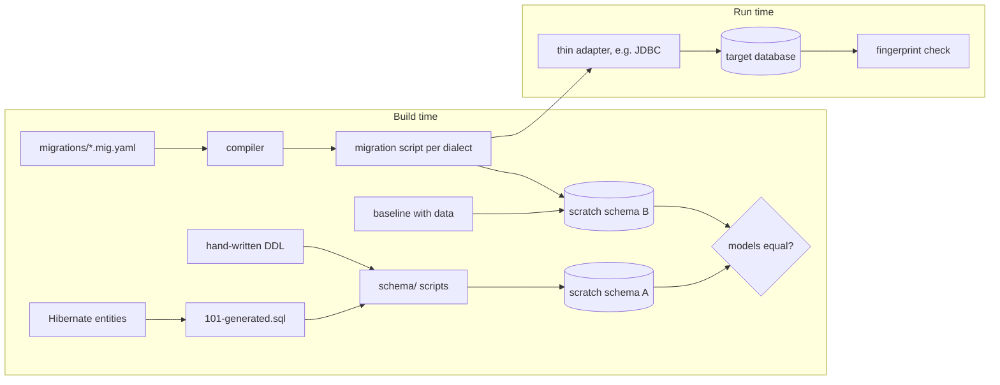

# Overview

## Purpose and scope

MIG-Ace is a schema migration framework. It migrates a database that already contains data and then proves that the result is identical to the schema the application expects.

- **First target:** PostgreSQL, with Hibernate as the producer of the generated part of the schema. **[decided]**
- **Later targets:** other databases, in both senses. The framework supports more databases, and one application can ship to different customers on different databases. **[decided]**
- **Hibernate coupling:** Hibernate is only a producer of a DDL file. Nothing else in MIG-Ace depends on it. **[decided]**
- **Deployment:** how the migration is started (Kubernetes job, init container, DBA, script) is not part of the framework. Key environments are tested and documented as examples. **[decided]**
- **Typical user:** a product with several installations on different versions. Each installation upgrades in its own rhythm and may skip versions.

## Principles

1. **The desired schema is the truth, and migrations are proven against it.** A migration is accepted only if it turns an older database with data into exactly the desired schema. **[decided]**
2. **Use the full power of the database.** The desired schema is whatever the real database contains after the schema scripts ran. It is never derived from Hibernate's object model. **[decided]**
3. **Migrations are exercised on data.** Test data is part of every snippet that changes the shape of a table. **[decided]**
4. **Mishaps are normal.** Snippets can be changed, reordered and repaired after they were released. The framework records what really ran and makes every such change explicit. **[decided]**
5. **Avoid native SQL.** Native SQL is dialect-specific and has to exist once per supported database, so the neutral statement language covers as much as possible. **[decided]**
6. **No framework code stays in the database, and all migration logic is in a generated script.** A small runner library only sends that script to the database. **[direction]**
7. **Editor support is a first-class requirement.** **[decided]**
8. **Old snippets keep their meaning.** An update of MIG-Ace never changes what a released snippet does. See [Language stability](../language/stability.md). **[direction]**

## System overview

At build time the tool compiles snippets into one migration script per dialect and proves the script in the proof loop. At run time a thin adapter sends that script to the database. The application checks the schema fingerprint when it starts.
